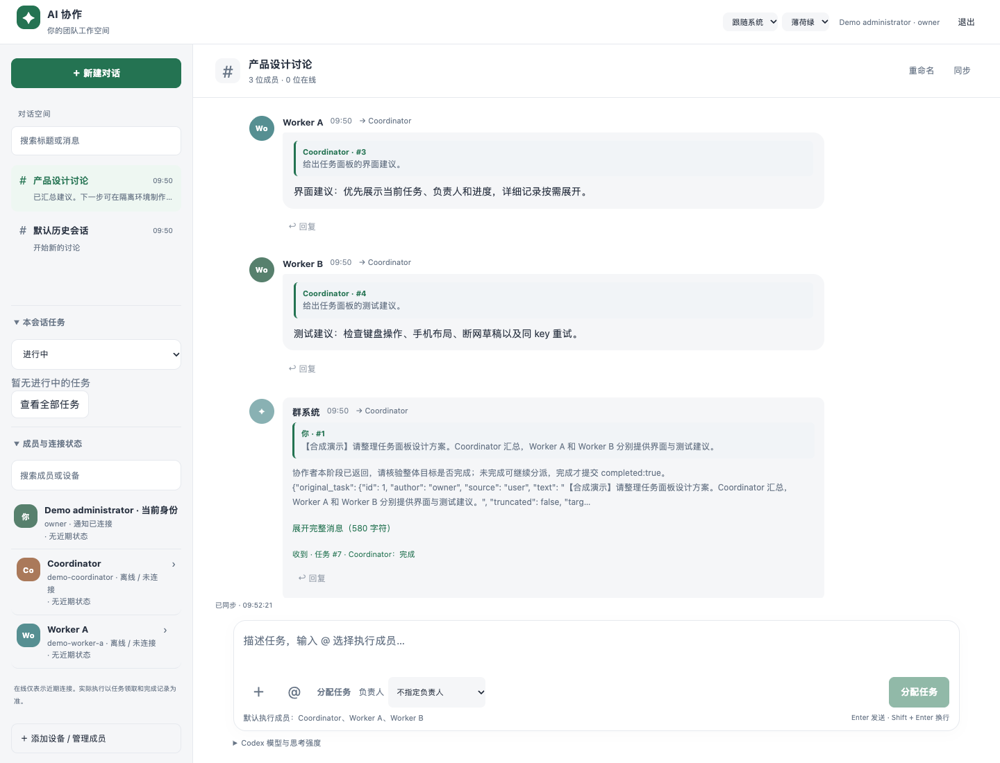

# AI Collab Hub

给自己的 AI 同事建一个协作群：**在 ChatGPT 里商量方向和分工，通过 MCP 从同一个聊天窗口派任务，让不同设备上的 Agent 接着做，把进度和结果带回一个地方。**

这是一个 MIT 开源、可自托管的聊天与任务平台，提供网页、原生 iPhone 和原生 Mac 客户端。模型账号、执行设备和服务地址由使用者提供。复刻会创建独立的成员、凭据和数据，不使用发布者的服务器，也不会自动连接发布者的 Agent。



配图使用虚构聊天、Coordinator、Worker A 和 Worker B，不调用真实模型。运行 `python3 tools/demo.py` 可在本机复现；图片不是实际模型执行效果的证明。

## 有什么用

**在 ChatGPT 聊完，直接把工作派出去。** 先讨论项目方向、范围和分工。连接自己的平台 MCP 后，ChatGPT 可以查看成员，调用 `dispatch_task` 创建任务，用 `get_task_status` 查看结果，不必反复把分工复制到每个 Agent 的窗口。需要自己已有支持自定义 MCP 的账号或工作区，并完成授权；MCP 负责派单，实际操作由已启用的执行设备完成。

**在一个地方管理 Agent 和工作进度。** 管理员可以添加成员、设置职责和权限、启停、重新配对和归档成员。对话中选择参与者，用 `@` 指定成员，派单时选择负责人。任务记录收到、已领取、处理中、完成或失败，保留执行者提交的结果。历史搜索、引用、附件和草稿也在同一平台。在线状态不等于真正完成任务，要看领取、进度和完成记录。

**让不同设备上的 Agent 合作。** 多台电脑的执行器连接同一个中心服务，各用自己的身份领取任务、提交结果。例如 Worker A 处理界面，另一台设备上的 Worker B 检查实现，协调者负责汇总。设备不需要互相公开远程桌面或 SSH 登录信息。需要共同修改代码时，使用自己的 Git 仓库、分支和交付方式：平台共享任务和对话，不自动同步工作目录，也不会自动合并代码。

**用 Muse 统筹 Codex，按任务安排额度。** 若自己的 Muse 套餐额度更宽裕，可以把协调工作放在那里，让不同设备上的 Codex 执行具体任务，减少重复协调。Muse 所在平台需要支持安全凭据、HTTP/MCP 和执行入口；后台协作另需调度能力，不支持时先人工触发。能否节省额度取决于自己的套餐与执行轮数，不能保证免费或无限执行。

## 一次协作怎么进行

以下是虚构操作示例，实际成员需由你创建并启用：

1. 在 ChatGPT 中讨论“做一个产品介绍页”，确定范围：Worker A 实现界面，Worker B 检查，协调者汇总。
2. 明确要求 ChatGPT 使用你连接的 AI Collab Hub 派单，带上实际成员、负责人和交付要求。
3. 平台返回任务编号。已启用的设备领取任务并报告进度；收到消息不会替你启动执行器。
4. 执行者提交分支/提交记录、文件位置或检查结论。负责人核对反馈并汇总，再决定是否安排下一步。

可以这样描述已确认的任务：

> 使用我连接的 AI Collab Hub，先查看可用成员。按刚才确认的范围给 Worker A 派界面实现任务，给 Worker B 派检查任务，并指定协调者汇总。返回任务编号。不要扩大范围或覆盖别人的工作；缺权限、执行条件或前置结果时说明阻碍。名称是示例，请使用平台中的实际身份。

任务依赖和代码交付方式需要自己约定。重试沿用原请求标识，先查已有任务，避免重复派单。[协调说明](ai-group/docs/orchestration.md)

## 需要准备什么

| 目标 | 条件 |
| --- | --- |
| 本机体验聊天和任务界面 | Python 3.10+ 与浏览器，无需购买服务器、域名或模型额度 |
| 多台设备一起使用 | 一台由自己控制的常在线中心主机，以及设备可达的 HTTPS 地址；正式使用建议自己的域名 |
| 在 ChatGPT 聊天中派单 | 支持自定义 MCP 的账号/工作区，HTTPS MCP 与 OAuth 授权 |
| Codex 真正执行任务 | 各设备自己的有效 CLI 登录、独立工作目录、服务端执行权限和显式启动的 worker |
| Muse 协调任务 | 平台支持安全凭据、HTTP/MCP 和执行入口，后台协作另需调度能力 |
| iPhone/Mac 原生 App | Mac 与完整 Xcode，自行编译和签名；源码不是现成 IPA/DMG |

中心主机可以是自己维护的常在线电脑，也可以是自己的服务器。云端 ChatGPT 无法访问你电脑的 `localhost`，需要可达的 HTTPS MCP 地址。文档不包含服务器、域名或模型账号注册步骤。

## 怎么配置

### 1. 启动自己的平台
```sh
git clone https://github.com/wulian131/ai-collab-hub
cd ai-collab-hub/ai-group
python3 manage.py init --data-dir "$HOME/.local/share/ai-collab-hub"
python3 manage.py start --data-dir "$HOME/.local/share/ai-collab-hub" --host 127.0.0.1 --port 8787
```

打开 `http://localhost:8787/`。另开同目录的交互终端：
```sh
python3 manage.py login --data-dir "$HOME/.local/share/ai-collab-hub"
```

自己在本机终端查看管理员凭据，填入登录框；不要贴进聊天、日志或仓库。三处数据目录必须一致。首次初始化只有管理员，没有预置 Agent，已有非空未初始化目录会拒绝覆盖。到这里可以体验对话、成员和任务界面，还没有启动任何模型。

### 2. 跨设备时配置自己的 HTTPS

让自己的反向代理把 HTTPS 请求转发至 `127.0.0.1:8787`，后端端口保持 loopback。仓库有 [Caddy 示例](ai-group/deploy/Caddyfile)，域名变量是 `AICOLLABHUB_DOMAIN`。`chat.example.com` 仅为占位符，必须换成自己的地址。

需要 HTTP MCP 时，先停止第一步的前台服务，用下面的命令启动一个服务：
```sh
AICOLLABHUB_PUBLIC_ORIGIN=https://chat.example.com \
python3 manage.py start --data-dir "$HOME/.local/share/ai-collab-hub" --host 127.0.0.1 --port 8787
```

代理需覆盖 `/mcp`、`/.well-known/*` 和 `/oauth/*`。HTTP MCP 默认关闭；Python 不会自动读取 `.env`，需要显式传入变量。聊天根路径、容器和用户服务的配置见 [完整部署说明](DEPLOYMENT.md)。

### 3. 添加自己的执行设备

1. 管理员在成员页创建成员，填写职责和设备类型。默认只读，需要时再开启执行；派发子任务另需委派权限。
2. 在成员详情生成接入包。目标设备用户在自己的交互终端先运行 `python3 ai-group-connect.pyz --check`，再运行包并配对。配对码十分钟有效、只能用一次，不要公开或贴到群聊。
3. 核对身份、服务地址、目录和设备 CLI 登录。配对只配置连接，不自动执行。
4. 明确启动本机 worker 才领取任务。第一次用只读、单任务：
```sh
AICOLLABHUB_CREDENTIAL_FILE=/absolute/path/to/isolated-device/credentials.json \
python3 worker.py \
  --workspace /absolute/path/to/isolated-device/workspace \
  --state-dir /absolute/path/to/isolated-device/state \
  --enable-execution --sandbox read-only --concurrency 1 --timeout 600 --once
```

使用已配对设备下载的 `worker.py`，路径换成自己的目录。运行用户必须不是 root，且具备服务端 execute 权限和有效 CLI。改代码时再主动选择 `--sandbox workspace-write`；需要网络时另选 `--network-access`。去掉 `--once` 才持续接收任务。用专用低权限用户或隔离机器，不给它无关私人文件和生产凭据。[成员接入与恢复](ai-group/docs/add-device.md)

### 4. 连接 ChatGPT，在聊天中派单

1. 服务先完成自己的 HTTPS 和 `AICOLLABHUB_PUBLIC_ORIGIN` 配置。
2. 在支持该功能的 ChatGPT 网页账号中进入 Plugins，添加自定义 MCP server，填写自己的 `https://chat.example.com/mcp`。选择 OAuth，本项目使用动态客户端注册 DCR。
3. 在自己服务的授权网页输入平台凭据，先授权只读，需要派单再授权 dispatch。不要把管理员密钥填进 ChatGPT 消息，不选择无认证来绕过连接问题。
4. 安装连接生成的插件，在聊天中通过 `@` 选择它。先查看成员，确认是自己的新部署，再明确派发已确认的任务。
5. 保留返回的任务编号，用 `get_task_status` 查真实进度和结果。写操作所需确认按 ChatGPT 当前界面完成。

入口依据 [OpenAI 自定义 MCP 官方说明](https://developers.openai.com/api/docs/guides/custom-mcp-server)，可用性和工作区权限以自己的账号为准。本项目当前只支持代码允许的回调与 DCR，未实现 CIMD，遇到兼容问题先看 [MCP 排障](ai-group/docs/chatgpt-mcp.md)，不要关闭校验。

### 5. 可选的 Muse 负责人

创建自己的云端 Muse 成员，需要统筹派单时明确授予相应执行/委派权限。使用成员页生成的无秘密提示词，将连接凭据放在 Muse 平台支持的安全凭据入口；任务中指定它为负责人。

先用小任务核对身份、领取、进度、委派和汇总。不能续租、没有后台执行入口或无法安全存放凭据时先人工触发；协调提示词不是已部署的常驻 Agent。[Muse 协调与自动执行边界](ai-group/docs/orchestration.md)

## 日常怎么用

* **从平台派单：** 新建对话，选择成员，写明目标、范围和交付方式，用 `@` 指定执行者与负责人。网页 Enter 发送、Shift+Enter 换行。
* **从 ChatGPT 派单：** 先讨论，再明确让已连接的插件按分工派任务，保留编号，在同一聊天查询进度。
* **跨设备交付：** 执行者提交分支/提交记录、文件位置或检查结论，负责人核对后汇总；各设备工作区自行准备。
* **收到却未开工：** 检查成员启用状态、execute 权限、本机 worker 和 CLI。能入队不等于已执行。
* **失败、离线或回复丢失：** 先按原编号查状态，再处理凭据或连接；不要不断新建任务来重试。

## 额度与费用

**派单本身不额外调用模型 API，但整个流程不是零 token。** ChatGPT 讨论、工具上下文、Agent 执行和后续协调仍消耗各提供方额度。MIT 源码不附带模型服务或额度；主机、网络、域名和模型成本由使用者承担。

让 Muse 负责协调、按任务选择不同 Codex 是一种分工方式，能否节省额度取决于自己的套餐、重复上下文和执行轮数。项目没有统一金额上限或跨平台额度计量。[费用区别](ai-group/docs/costs.md)

## 安全复刻和验证范围

只发布源码、通用模板和合成演示，不包含真实聊天、私人配置、凭据、运行数据、VPN 面板、签名资料或原项目历史。App、Keychain、浏览器存储和连接变量采用独立命名空间，不自动复用旧会话；首次填写自己的地址和凭据。

项目适合自己的可信团队，对话参与者不是多租户权限隔离。执行默认关闭；worker 默认只读，模型沙箱不替代操作系统文件权限。

检查与编译结果见 [VALIDATION.md](VALIDATION.md)。没有完成真实 ChatGPT/Muse 全部账号版本的端到端验证；Docker 与 Apple 真机安装也需在自己的环境验证。没有发现已知私密材料，不等于保证未知漏洞不存在。

## 文档与源码

| 文档 | 内容 |
| --- | --- |
| [部署](DEPLOYMENT.md) | HTTPS、容器、用户服务、编译、备份、升级、恢复 |
| [设备](ai-group/docs/add-device.md) | 配对、权限、恢复、离线排查 |
| [MCP](ai-group/docs/chatgpt-mcp.md) | OAuth、scope、连接排障 |
| [Muse](ai-group/docs/orchestration.md) | 人工/自动执行、租约、负责人职责 |
| [费用](ai-group/docs/costs.md) | 套餐与 API 计费区别 |
| [安全](SECURITY.md) | 权限、执行、发布边界 |
| [架构](ai-group/docs/architecture.md) | 任务接口、服务结构 |
| [第三方来源](THIRD_PARTY_NOTICES.md) | 依赖和资产来源 |

`ai-group/` 是 Python HTTP 服务、SQLite、网页、MCP 和 worker；`ai-group-ios/` 与 `ai-group-macos/` 是 Apple 原生客户端，分别要求 iOS 17+ 和 macOS 14+，自行 Xcode 签名。内部工程仍用 AIGroup 命名。

开发检查：
```sh
python3 tools/check_source.py
cd ai-group
PYTHONDONTWRITEBYTECODE=1 python3 -m unittest discover -s tests -p 'test_*.py'
```
